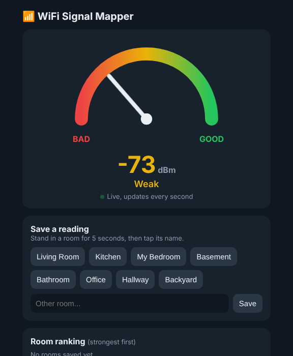

# ESP32 WiFi Signal Mapper

An ESP32 that finds the WiFi dead zones in a house. The board joins the home WiFi, measures signal strength (RSSI) every second, and hosts its own live dashboard. Any phone on the same network can open it. Walk room to room with the board on a power bank, tap the room name, and the dashboard ranks every room from strongest to weakest.



## What it does

- **Live signal dial:** a needle moves from BAD (red) to GOOD (green) and updates every second
- **Room readings:** tap a room button to save the average of the last 5 readings, which smooths out normal jumps of a few dBm
- **Room ranking:** colour-coded bars sorted from strongest to weakest, so dead zones stand out
- **Dead-zone alert:** if the board drops off the network, the page shows "Board not reachable"
- **No app or internet needed:** the ESP32 is the web server, reachable at its local IP or `http://wifimap.local`

## Findings in my house

- **Strongest:** upstairs bedroom
- **Dead zones:** the basement and the far end of the living room

## How it works

| Part | Job |
|---|---|
| `WiFi.h` | Joins the home network and reads RSSI with `WiFi.RSSI()` |
| `WebServer.h` | Runs a small HTTP server on port 80 |
| `/` | Sends the dashboard page (HTML, CSS, JavaScript stored in `page.h`) |
| `/data` | Returns the current signal as JSON, for example `{"rssi":-62}` |
| `ESPmDNS.h` | Lets the board be found at `wifimap.local` |

The page's JavaScript asks `/data` for a new reading every second, then moves the needle and updates the colour.

**Reading the numbers (dBm):** values are always negative, and closer to 0 is stronger. Around -40 is excellent, -60 is good, -70 is weak, and -80 or lower is a dead zone.

## Hardware

- ESP32 development board (ESP32-WROOM-32, "ESP32 Dev Module" in Arduino IDE)
- Micro-USB cable
- Any USB power bank, for walking the house

## Setup

1. Install [Arduino IDE 2](https://www.arduino.cc/en/software).
2. In **Settings**, add this to *Additional boards manager URLs*:
   `https://espressif.github.io/arduino-esp32/package_esp32_index.json`
3. In **Boards Manager**, install **esp32 by Espressif Systems**.
4. Open `WiFiMapper/WiFiMapper.ino`.
5. Copy `secrets.example.h`, rename the copy to `secrets.h`, and type your WiFi name and password. `secrets.h` is in `.gitignore`, so it never gets uploaded.
6. Select **ESP32 Dev Module** and your board's USB port, then click **Upload**.
7. Open the Serial Monitor at **115200 baud** to see the board's address, then open it on a phone on the same WiFi.

The ESP32 only connects to 2.4 GHz WiFi.

## Project structure

```
WiFiMapper/     Live dashboard version (main project)
  WiFiMapper.ino    WiFi connection, web server, routes
  page.h            Dashboard web page
  secrets.example.h Template for your WiFi details
WiFiSignal/     First version: prints signal strength to the Serial Monitor
```

## Challenges I solved

- **Dashboard loaded but never updated.** Arduino's pre-compile step was inserting C++ lines into the JavaScript inside my `.ino` file. Moving the page into its own `page.h` file fixed it.
- **Example code wouldn't compile.** `LED_BUILTIN` isn't defined for this board, so I set it to GPIO 2.
- **Scrambled Serial Monitor output.** The baud rate didn't match the code (9600 vs 115200).
- **Keeping my WiFi password out of public code.** Credentials live in `secrets.h`, which Git ignores.

## Next

Two ESP32 boards talking directly with **ESP-NOW** (no router), measuring range and packet loss through walls.

---
Built by Rayyan Ali.
